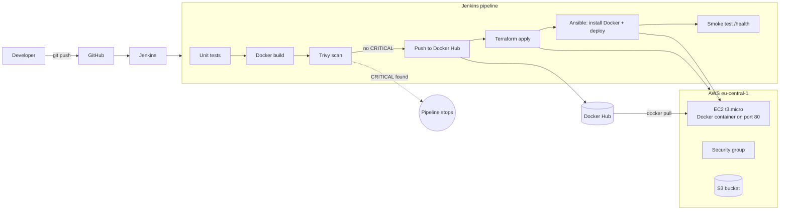

# Infrastructure as Code Lab on AWS

> This README was generated with [Claude] as per my command.

An end-to-end DevOps project that builds AWS infrastructure from code, configures it automatically and deploys a containerized web app through a CI/CD pipeline with a security gate. The whole environment can be created and torn down with one pipeline run.

## Highlights

- **Infrastructure as code:** Terraform creates an EC2 server, a security group, an SSH key pair and a private, encrypted S3 bucket.
- **Configuration management:** Ansible installs Docker on the new server and deploys the app container.
- **CI/CD:** a Jenkins pipeline runs unit tests, builds the image, scans it, pushes it to Docker Hub, provisions AWS and deploys, then checks the app's health endpoint.
- **Security gate:** Trivy scans every image and stops the pipeline on critical vulnerabilities, so an insecure image never reaches the server.
- **Kubernetes:** the same container runs on a local minikube cluster with a Deployment (2 replicas, health probes, resource limits) and a NodePort Service.
- **Secure defaults:** SSH only from your own IP, IMDSv2 enforced, encrypted disk, S3 public access blocked, no secrets in the repo.

## Architecture



## Tech stack

| Area | Tools |
|---|---|
| Cloud | AWS (EC2, S3, IAM, VPC, security groups) |
| Infrastructure as code | Terraform |
| Configuration management | Ansible |
| CI/CD | Jenkins (declarative pipeline), Git, GitHub |
| Containers | Docker, Docker Hub |
| Security | Trivy image scanning |
| Orchestration | Kubernetes (minikube) |
| Application | Python, Flask, Gunicorn, pytest |

## Pipeline stages

| # | Stage | What happens |
|---|---|---|
| 1 | Unit tests | `pytest` runs the app tests |
| 2 | Build image | Docker builds the image for `linux/amd64`, tagged with the build number |
| 3 | Security scan | Trivy fails the build on CRITICAL vulnerabilities that have a fix |
| 4 | Push image | Image is pushed to Docker Hub |
| 5 | Terraform | Creates or updates the AWS resources (or destroys them with `ACTION=destroy`) |
| 6 | Ansible: install Docker | Prepares the fresh Ubuntu server |
| 7 | Ansible: deploy app | Pulls the new image and restarts the container |
| 8 | Smoke test | Calls `/health` on the public URL |

## Repository structure

```
iac-lab/
├── app/                    Flask app, unit tests, Dockerfile
├── terraform/              EC2, security group, key pair, S3 bucket, outputs
├── ansible/                install-docker.yml, deploy-app.yml
├── k8s/                    Deployment and Service for minikube
├── jenkins/                Dockerfile + docker-compose.yml for a ready-to-use Jenkins
└── Jenkinsfile             CI/CD pipeline
```

---

## Getting started

### Prerequisites

- Docker Desktop (or Docker Engine on Linux)
- An AWS account, a Docker Hub account (free)
- Terraform and Ansible, only for the manual run (the Jenkins image already includes them)
- minikube and kubectl, for the Kubernetes part

> **Windows:** use WSL2 (Ubuntu). Ansible does not run natively on Windows.

```bash
git clone https://github.com/Dinesh16680-M/iac-lab.git
cd iac-lab
```

### One-time setup

1. **AWS user:** in IAM, create a user `iac-lab` with `AmazonEC2FullAccess` and `AmazonS3FullAccess`, then create an access key for CLI use. Don't use the root account.
2. **Budget alarm:** Billing → Budgets → *Zero spend budget*, so AWS emails you if anything starts costing money.
3. **SSH key:**
   ```bash
   ssh-keygen -t ed25519 -f ~/.ssh/iac-lab -N ""
   ```
4. **Docker Hub token:** Account settings → Personal access tokens → Generate (Read & Write).

### Option A: run each step by hand

**1. Build, run and scan the app locally**

```bash
docker build -t iac-lab-app:local app
docker run --rm -p 8080:8080 iac-lab-app:local          # http://localhost:8080
docker run --rm -v /var/run/docker.sock:/var/run/docker.sock \
  aquasec/trivy:0.65.0 image --severity HIGH,CRITICAL iac-lab-app:local
```

**2. Create the infrastructure**

```bash
export AWS_ACCESS_KEY_ID=...
export AWS_SECRET_ACCESS_KEY=...

cd terraform
cp terraform.tfvars.example terraform.tfvars
# set allowed_ssh_cidr to "<your IP>/32" (curl -s https://checkip.amazonaws.com)
# set ssh_public_key to the contents of ~/.ssh/iac-lab.pub
terraform init
terraform plan
terraform apply
```

Terraform prints the server IP, the app URL and an SSH command, and writes `ansible/inventory.ini`.

**3. Push the image and deploy with Ansible**

```bash
docker login
docker build --platform linux/amd64 -t <DOCKERHUB_USER>/iac-lab-app:latest app
docker push <DOCKERHUB_USER>/iac-lab-app:latest

cd ansible
ansible-galaxy collection install -r requirements.yml
ansible web -m ping
ansible-playbook install-docker.yml
ansible-playbook deploy-app.yml -e app_image=<DOCKERHUB_USER>/iac-lab-app:latest
```

Open the `app_url` from the Terraform output.

**4. Tear down**

```bash
cd terraform && terraform destroy
```

### Option B: the full Jenkins pipeline

**1. Start Jenkins**

```bash
cd jenkins
docker compose up -d --build
docker exec iac-lab-jenkins cat /var/jenkins_home/secrets/initialAdminPassword
```

Open http://localhost:8080, paste the password, install the suggested plugins and create an admin user.

**2. Add credentials** (Manage Jenkins → Credentials → Global)

| ID | Kind | Value |
|---|---|---|
| `aws-creds` | Username with password | access key ID / secret access key |
| `dockerhub-creds` | Username with password | Docker Hub user / access token |
| `ec2-ssh-key` | SSH Username with private key | user `ubuntu`, contents of `~/.ssh/iac-lab` |

**3. Create the job**

New Item → *Pipeline* → Pipeline script from SCM → Git → `https://github.com/Dinesh16680-M/iac-lab.git`, branch `*/main`, script path `Jenkinsfile`.

Run **Build Now** once so Jenkins loads the parameters (this first run may fail), then **Build with Parameters** with `ACTION=deploy` and your Docker Hub user. The last stage prints the app URL.

To delete everything on AWS, run it again with `ACTION=destroy`.

> Terraform state lives in the Jenkins workspace (the `jenkins_home` volume). Run `destroy` before deleting the job or the volume.

**Try it out**

- Change the `<h1>` in `app/app.py`, push and rebuild: the new build number appears on the page.
- Change the base image to `python:3.8-slim-buster`, push and rebuild: Trivy finds critical vulnerabilities and the pipeline stops before deploying.

### Option C: Kubernetes on minikube

```bash
minikube start
minikube image build -t iac-lab-app:local app
kubectl apply -f k8s/
kubectl get pods
minikube service iac-lab-app
```

Scale it, delete a pod and watch Kubernetes replace it:

```bash
kubectl scale deployment iac-lab-app --replicas=4
kubectl delete pod <pod-name>
```

Clean up with `kubectl delete -f k8s/` and `minikube stop`.

---

## Cost and cleanup

Everything is sized for the AWS free tier: one `t3.micro` instance, an 8 GB gp3 disk and an empty S3 bucket in `eu-central-1`. Without free tier it costs roughly $0.015 per hour while running. Since July 2025 new AWS accounts get a credit-based free plan instead of the 12-month free tier, so check yours under Billing → Free tier.

- Always run `terraform destroy` (or the `destroy` build) when you're done.
- Keep the budget alarm on.
- All resources are tagged `Project = iac-lab`, so leftovers are easy to find in the console.

## Troubleshooting

| Problem | Fix |
|---|---|
| Ansible `UNREACHABLE` / SSH timeout | Your IP changed. Update `allowed_ssh_cidr` and run `terraform apply` again (Jenkins does this automatically). |
| `Permission denied (publickey)` | The public key in Terraform doesn't match `~/.ssh/iac-lab`; run `chmod 600 ~/.ssh/iac-lab`. |
| `Unsupported instance type` | Some regions use `t2.micro` for the free tier; set `instance_type = "t2.micro"`. |
| `exec format error` on the server | The image was built for ARM; build with `--platform linux/amd64`. |
| Trivy stage fails | Working as intended: update the base image or the package versions in `requirements.txt`. |
| minikube `ErrImageNeverPull` | Run `minikube image build -t iac-lab-app:local app` again. |

## Roadmap

- Remote Terraform state in S3 with locking
- Amazon ECR instead of Docker Hub
- GitHub webhook to trigger the pipeline on every push
- Deploy the Kubernetes manifests to Amazon EKS
